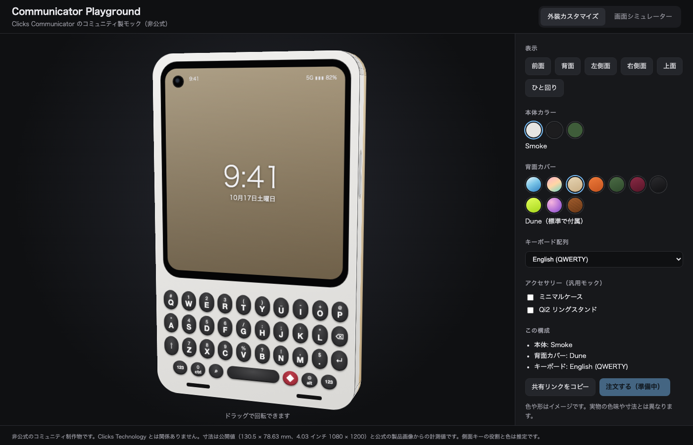
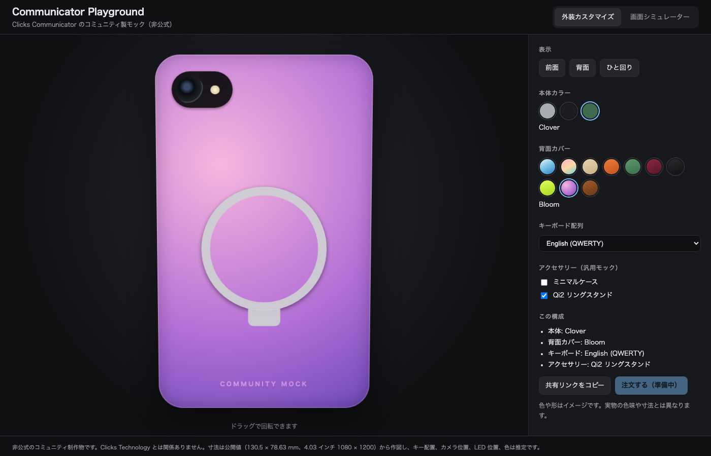
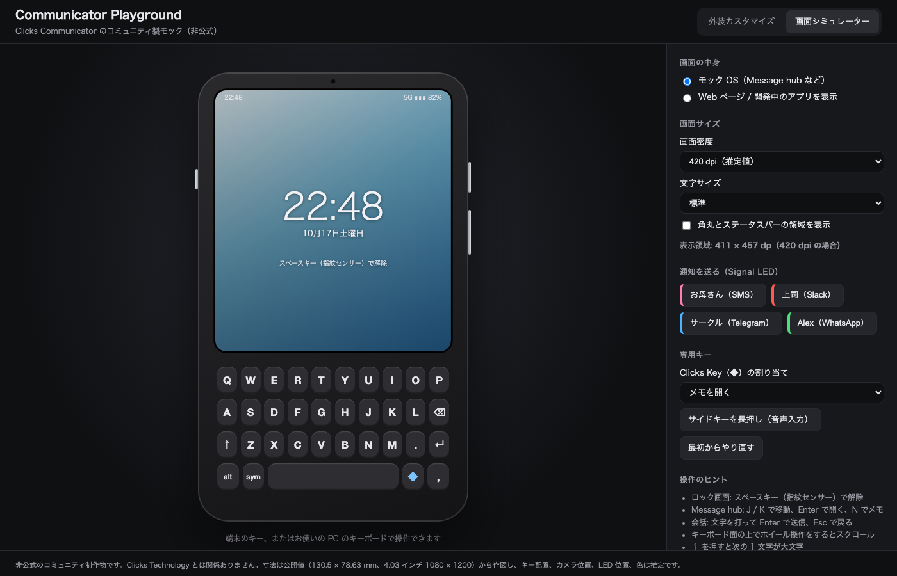

# Communicator Playground（非公式コミュニティ版）

Clicks Communicator の外装を着せ替えて見たり、モック画面の中でアプリの動きを試したりできる Web ページと、開発者向けの資料をまとめたものです。

> 非公式のコミュニティ制作物です。Clicks Technology とは関係ありません。
> 寸法は公開値（130.5 × 78.63 mm、4.03 インチ 1080 × 1200）と、公式の製品画像からの計測値です（[計測値と出典](docs/measurements.md)）。側面キーの役割と色は推定です。

| 外装カスタマイズ | 背面とアクセサリー | 画面シミュレーター |
|---|---|---|
|  |  |  |

## すぐに試す

**公開ページ: https://daikiito-dk.github.io/communicator-playground/**

手元で動かす場合も、ビルドは不要です。静的ファイルを配信するだけで動きます。

```bash
cd web
python3 -m http.server 8765
# ブラウザで http://localhost:8765 を開く
```

## できること

### 外装カスタマイズ

- 本体カラー 3 色と背面カバー 10 種類の組み合わせを切り替え
- ドラッグで 3D 風に回転、前面と背面の切り替え
- キーボード配列（QWERTY / AZERTY / QWERTZ）の切り替え
- 汎用アクセサリーのモック（ミニマルケース、Qi2 リングスタンド）
- 構成を URL に保存して共有（例: `#body=clover&cover=bloom&ring=1&view=back`）

### 画面シミュレーター

- モック OS: ロック画面、Message hub、会話、メモ
- 画面のキー、または PC のキーボードで操作（J / K、Enter、Esc など）
- 通知を送ると Signal LED が相手ごとの色で点滅
- alt / 123 キーで上段の記号・数字を入力、左側面のキルスイッチでマイクをオフ
- Clicks Key の割り当て変更、サイドキー長押しでの音声入力の再現
- キーボード面でのホイール操作でスクロール（タッチ式キーボードの再現）
- 画面密度と文字サイズを切り替えて、dp サイズでの見え方を確認
- 任意の URL（ローカルの開発サーバーなど）をモック画面の中に表示

## 構成

```
web/                  Web ページ（ビルド不要の HTML / CSS / JS）
  js/catalog.js       本体色、カバー、配列、アクセサリーのデータ
  js/device.js        端末モックの描画部品（両タブで共通）
  js/customizer.js    外装カスタマイズ
  js/simulator.js     画面シミュレーター
avd/                  Android Studio 用のハードウェアプロファイルと AVD 作成スクリプト
tools/                エミュレーター用スキンの生成スクリプト
docs/                 キーボード優先の開発チェックリスト、日本語入力ガイド
```

## 今後の拡張

| 段階 | 内容 | 準備済みの部分 |
|---|---|---|
| 精度を上げる | 実機を実測して寸法、カメラ位置、色を更新。本格的な 3D（glTF）と AR 表示へ | 寸法は mm 単位の定数にまとめてあります |
| 関連商品の販売・発注 | 商品データに SKU、価格、在庫を追加し、EC（Shopify など）のカートや見積もり依頼につなぐ | 商品データは `catalog.js` に分離。構成は URL で受け渡しできます。「注文する」ボタンは無効のまま置いてあります |
| 法人向けデスクトップ版 | 同じ Web コードを Electron または Tauri で包み、オフラインで動くシミュレーターとして配布 | 外部ライブラリとビルド手順に依存しないので、そのまま包めます |

販売や配布を始める前に、Clicks の名称、ロゴ、製品画像の扱いについて Clicks から許諾を得る必要があります。dbrand などの他社アクセサリーを扱う場合も同じです。

## 参加するには

実機をお持ちの方の情報を特に募集しています。[Issue](https://github.com/daikiito-dk/communicator-playground/issues/new/choose) のテンプレートから投稿してください。

- **実機の寸法・画面情報の報告:** 画面密度（`adb shell wm density`）、カメラやキーの位置など。モックの精度を上げるのに使います
- **日本語入力の検証結果:** IME ごとの使い勝手。[日本語入力ガイド](docs/japanese-input-guide.md) にまとめます
- **不具合・改善の提案:** Web ページやスクリプトについて

発売前の機密情報（NDA の対象になっている情報）や、Clicks の公式画像の転載は投稿しないでください。

`main` に push すると、`web/` の内容が GitHub Pages に自動で公開されます（`.github/workflows/pages.yml`）。

## ライセンス

[MIT](LICENSE)。Clicks、Communicator の名称と商標は Clicks Technology に帰属します。

## 既知の制限

- 画面、キー、パンチホール、スピーカー、側面キーの位置は製品画像からの計測値です（誤差 ±0.5〜1 mm 程度）。側面キーの役割、色、質感は推定です。
- 埋め込みを禁止しているサイト（`X-Frame-Options` など）はシミュレーターに表示できません。
- 日本語の変換入力はモック OS では再現していません（PC 側で変換中のキー入力は無視します）。
